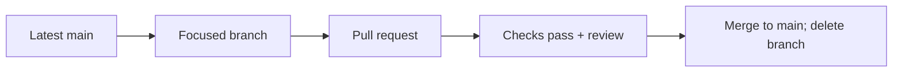

# Contributing to PsyPedia

## Table of Contents

- [Local Development](#local-development)
- [Branches and Workflow](#branches-and-workflow)
- [Pull Requests and CI](#pull-requests-and-ci)
- [Changelog](#changelog)
- [Environments and Releases](#environments-and-releases)
- [Conventions](#conventions)
- [UI components](#ui-components)
- [Backend structure](#backend-structure)

## Local Development

Follow the [quickstart](README.md#quickstart). Run Make commands from the repository
root; Node.js and Python run inside Docker.

| Action | Command |
| --- | --- |
| Start development | `make up` |
| Update source | Save files; Vite and Flask reload automatically |
| Update dependencies or Dockerfiles | Stop, run `make setup`, then `make up` |
| Change ports, provider, or model | Edit `.env` and restart with `make up` |
| Stop and remove containers | `make down` |
| Inspect app / model logs | `make logs` / `make logs-ollama` |
| List commands | `make help` |

For model preparation, persistent downloads, and startup failures, see
[backend configuration](backend/README.md#ollama-configuration-and-errors).

## Branches and Workflow

We use **GitHub Flow**: short-lived branches return to `main` through reviewed pull
requests. There is no permanent `develop` branch.

```sh
git switch main
git pull --ff-only origin main
git switch -c feature/chat-interface
```

Use `feature/`, `fix/`, `docs/`, `refactor/`, or `chore/` followed by a short name.
Keep commits focused and unrelated changes in separate pull requests.



## Pull Requests and CI

Complete the [PR template](.github/pull_request_template.md): link the issue, mark
only verified criteria, and record actual results and remaining limitations.

| Check | Command |
| --- | --- |
| Backend tests | `make test` |
| Vue tests, TypeScript, and frontend build | `make build-frontend` |
| Both checks above | `make check` |
| HTTP integration, with `make up` running | `make test-integration` |
| Local LLM evaluation, with Ollama mode running | `make evaluate-llm` |
| Configuration and whitespace | `docker compose -f compose.dev.yaml config --quiet` and `git diff --check` |

CI runs syntax checks, backend/frontend tests, the frontend build, and HTTP
integration on pull requests and pushes to `main`. It creates `.env` from the
example and uses mock mode, without model downloads. GitHub branch protection
must separately enforce required checks. Real-model quality is reviewed through
[synthetic evaluation](backend/README.md#real-model-evaluation), outside CI.

For changes to AI behavior (model, prompts, knowledge, retrieval, guards, history,
providers, or generation options), rerun relevant synthetic cases, review the raw
answers, and update the [LLM report summary](backend/evaluation/reports/summary.md).
Follow the [summary workflow](backend/README.md#evaluation-summaries) and link the
updated results in the PR, including failures and pending human review.

## Changelog

Update [Unreleased](CHANGELOG.md#unreleased) for notable behavior changes, using
[Keep a Changelog](https://keepachangelog.com/en/1.1.0/) categories. Describe the
resulting behavior, not every commit. Move entries to a dated version when releasing.

## Environments and Releases

Only local development is configured. The intended release process validates a
specific `main` commit in staging, then promotes **the same commit or artifact**
to production. Record releases with fixed tags such as `v0.1.0`.

Use Semantic Versioning: major for breaking changes, minor for compatible features,
and patch for fixes. For an urgent production fix, branch from the deployed tag if
needed and bring the fix back to `main`.

## Conventions

- Follow `.editorconfig`; keep documentation and developer diagnostics in English, UI text in Spanish.
- Define runtime versions in Dockerfiles and pin backend dependencies.
- Commit `package.json` and `package-lock.json` together.
- Share configuration in `.env.example`; keep secrets, patient information, local environments, and generated files out of Git.
- Frontend `VITE_*` variables are public.

## UI components

Use existing Tailwind/shadcn-vue controls in `frontend/src/components/ui/`, chat
components in `components/chat/`, and state in `composables/`. The `@/` alias points
to `frontend/src/`.

The UI is light-only and mobile-first. Reuse tokens from `styles/theme.css` and
`style.css`, avoid component-specific hex colors, and keep interactive targets at
least 44px. Review generated components and dependency changes before committing.

## Backend structure

Keep HTTP handling, chat coordination, knowledge, prompting, and providers separate.
See the [backend README](backend/README.md) for responsibilities and setup, and
[LLM and prompting](backend/LLM_AND_PROMPTING.md) for routing and limitations.
