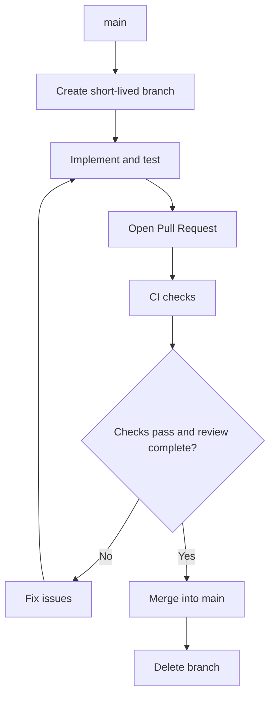

# 🤝 Contributing to PsyPedia

This guide explains how to run PsyPedia locally, contribute changes, and follow our Git and release workflow.

## 📑 Table of Contents

- [🤝 Contributing to PsyPedia](#-contributing-to-psypedia)
  - [📑 Table of Contents](#-table-of-contents)
  - [Local Development](#local-development)
  - [Branches and Workflow](#branches-and-workflow)
    - [Branch Naming](#branch-naming)
    - [Development Workflow](#development-workflow)
  - [Pull Requests and CI](#pull-requests-and-ci)
    - [Pull Request Template](#pull-request-template)
    - [Continuous Integration (CI)](#continuous-integration-ci)
  - [Changelog](#changelog)
  - [Environments and Releases](#environments-and-releases)
    - [Versioning](#versioning)
  - [Conventions](#conventions)

## Local Development

Install **Git, Make, and Docker with Compose v2**, and ensure Docker is running. Node.js and Python run inside containers.

From the repository root:

```sh
cp .env.example .env
make up
```

Open [http://localhost:5173](http://localhost:5173), or the configured port.

| Action | Command |
|---|---|
| Start development | `make up` |
| Update source code | Save files; Vite HMR and Flask auto-reload apply changes |
| Update dependencies or Dockerfiles | Stop with `Ctrl+C`, run `make setup`, then `make up` |
| Change ports | Edit `.env` and restart with `make up` |
| View available commands | `make help` |

`make up` reuses existing images or builds missing ones. This setup is intended for **development only**.

## Branches and Workflow

We follow **GitHub Flow**, similar to trunk-based development: short-lived branches merge into `main`, without a permanent `develop` branch.

Create a branch from the latest `main`:

```sh
git checkout main
git pull --ff-only origin main
git checkout -b feature/chat-interface
```

### Branch Naming

| Prefix | Purpose | Example |
|---|---|---|
| `feature/` | New features | `feature/chat-interface` |
| `fix/` | Bug fixes | `fix/chat-validation` |
| `docs/` | Documentation | `docs/api-guide` |
| `refactor/` | Code restructuring | `refactor/rag-service` |
| `chore/` | Maintenance | `chore/update-dependencies` |

### Development Workflow



Keep commits focused and link the relevant GitHub Issue when applicable.

---

## Pull Requests and CI

### Pull Request Template

A **Pull Request template** is provided in the repository. Complete it when opening a PR, including:

- **Description:** What changed and why.
- **Related Issue:** Link the corresponding task.
- **Testing:** Explain how the changes were verified.
- **Checklist:** Confirm relevant requirements are met.

### Continuous Integration (CI)

CI runs automatically on pull requests to `main` and pushes to `main`, checking backend syntax and tests, Vue component tests, TypeScript, the frontend build, and the Vite-to-Flask HTTP integration.

Run `make check` locally when possible, review CI results, and fix failures before merging. In the PR template, record which tests were performed, their results, and any pending checks. 

Required-check enforcement must be configured in GitHub branch protection or rulesets.

For integration checks, run `make up`, then `make test-integration` in another terminal. The test checks HTTP status, JSON content type, and the health response both directly from Flask and through Vite. It uses internal container addresses, so custom host ports work unchanged. CI starts and cleans up its own stack automatically.

## Changelog

All notable changes are documented in [`CHANGELOG.md`](CHANGELOG.md), following the [Keep a Changelog](https://keepachangelog.com/en/1.1.0/) format.

- **Unreleased:** Changes not yet included in a release.
- **Added:** New features.
- **Changed:** Updates to existing functionality.
- **Fixed:** Bug fixes.
- **Removed:** Removed functionality.
- **Security:** Security-related changes.

Update the **Unreleased** section when making notable changes. When publishing a release, move its entries to a versioned section (e.g., `v0.1.0`) and include the release date.

The changelog should describe user-visible changes, not every individual commit.

## Environments and Releases

| Environment | Purpose | Status |
|---|---|---|
| **Development** | Local Docker environment | Available |
| **Staging** | Validate a release candidate | Not configured |
| **Production** | Run an approved release | Not configured |

We develop in `main`. A specific commit is tested in staging, then the **same commit or artifact** is promoted to production.

Releases are identified using Git tags, such as `v0.1.0`.

### Versioning

We use **Semantic Versioning** (`MAJOR.MINOR.PATCH`):

| Number | Meaning | Example |
|---|---|---|
| **Major** | Breaking changes | `1.0.0` → `2.0.0` |
| **Minor** | Backward-compatible features | `1.0.0` → `1.1.0` |
| **Patch** | Backward-compatible bug fixes | `1.0.0` → `1.0.1` |

Versions beginning with `0`, such as `v0.1.0`, indicate initial development.

For urgent production fixes, branch from the deployed tag if necessary, then merge the fix back into `main`.

## Conventions

- Follow `.editorconfig`.
- Define runtime versions in Dockerfiles.
- Commit `package.json` and `package-lock.json` together.
- Pin backend dependencies in `backend/requirements.txt`.
- Share configuration through `.env.example`.
- Never commit secrets, patient information, local environments, or generated files.
- Remember that frontend `VITE_*` variables are publicly exposed.

## UI components

The frontend uses Tailwind CSS v4 and shadcn-vue. Keep reusable controls in `src/components/ui/`, chat components in `src/components/chat/`, and conversation state in `src/composables/`. Import source files with the `@/` alias.

To add a shadcn component from the repository root, use Docker:

```sh
docker run --rm --mount "type=bind,src=$(pwd)/frontend,dst=/app" --workdir /app node:22.23.3-alpine npx shadcn-vue@2.8.2 add button
```

Review generated files and dependency changes, then run `make setup` and `make up`. `make check` includes chat component tests and the frontend build. The current chat stores messages in memory and displays a disconnected-assistant notice; it does not call a chat API or AI service. Messages are cleared on refresh; clinical sources are not integrated.

The UI is light-only and mobile-first. Brand tokens live in `frontend/src/styles/theme.css`; semantic aliases in `src/style.css` adapt them to shared controls. Use those tokens rather than component-specific hex colors. Start with small-screen styles, add wider breakpoints, and keep interactive targets at least 44px.
