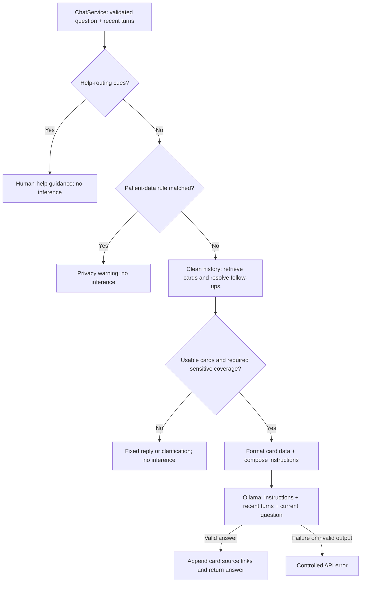

# LLM integration and prompting

## Table of Contents

- [How it works](#how-it-works)
- [Knowledge and prompting folders](#knowledge-and-prompting-folders)
- [Current behavior](#current-behavior)
- [Configuration and checks of the LLM behaviour](#configuration-and-checks-of-the-llm-behaviour)
- [Limitations](#limitations)

## How it works

This shows the Ollama path. Mock mode applies the same emergency/privacy checks,
then returns a fixed demo answer without retrieval or inference. Bare agreement
without a recoverable topic asks for clarification instead of selecting a therapy.

## Knowledge and prompting folders

| File | Responsibility |
| --- | --- |
| [`knowledge/topics.json`](psypedia/knowledge/topics.json) | Names, categories, aliases, summaries, and public source metadata |
| [`knowledge/retrieval.py`](psypedia/knowledge/retrieval.py) | Validate named topics and select aliases or broad categories |
| [`prompting/context.py`](psypedia/prompting/context.py) | Format selected facts and Spanish names as data, without behavioral instructions |
| [`prompting/prompts.py`](psypedia/prompting/prompts.py) | Own all model instructions, including continuation/rewrite guidance, and compose the prompt |

**Single source of truth:** `prompts.py` owns permanent rules and the wording for
continuations and repeated-answer retries. `context.py` contains only card
formatting. The service requests continuation or a retry; the provider
handles HTTP and model options. Cards supply context, **not model training**.
See [card sources and scope](psypedia/knowledge/README.md).

## Current behavior

- **Language:** the UI and fixed replies use Spanish; the model is instructed to
  do the same. Documentation and developer diagnostics use English.
- **Knowledge:** no usable cards means a fixed information limitation. Partial
  coverage keeps available cards, adds an application limitation notice, and asks
  the model to explain only that part, without equating unknown labels. User-supplied
  names remain in the user message; the system receives only a partial-coverage flag.
  Supported questions use card-only rewriting;
  broad category requests use the relevant cards for an overview. Specific names
  take priority. See [category scope](psypedia/knowledge/README.md#integration).
  Current cards determine what can be explained, even after an earlier missing-information reply.
  Greetings, thanks, and capability questions can use fixed replies.
- **Sensitive topics:** educational suicide/self-harm/injury questions require
  explicit `covered_topics` metadata (`suicide`, `self_harm`, `injury`). Current
  cards declare none; these questions receive an information limitation, not an
  emergency response merely because they mention a sensitive topic.
- **Follow-ups:** Vue sends up to 12 recent turns, excluding its initial welcome
  and source metadata. Explicit continuations can reuse a previous topic;
  recognised indecision can select an introductory card. Contextual continuations and
  one bounded rewrite attempt address exact repetition. The backend stores no history.
  When cards are available, application-only missing-information notices are excluded
  from model memory; questions and substantive replies remain available.
- **Patient information:** rules share patient/client vocabulary. Detected case/contact data in the current message
  triggers a privacy warning. A new general question can continue: history up to
  the last detected turn, plus its immediate assistant replies, is excluded from
  inference. This does not erase the browser conversation; refresh clears it.
- **Help routing:** the [signal analyser](psypedia/services/emergency.py) combines
  subject, harm concepts, intention/reported action, and urgency within clauses.
  It checks negation, educational framing, and attributed speech before selecting
  guidance. The same analysis handles recent risk context; it does not store a
  separate rule for each example. Guidance precedes privacy, addresses the
  professional where applicable, and includes conditional 112 direction for Spain/EU.
  A new topic ends that context; isolated sensitive terms receive conditional help.
- **Output:** the adapter requests non-thinking output, removes marked reasoning
  blocks, and rejects incomplete blocks or token-limit truncation. The prompt asks
  for short paragraphs without Markdown. The [chat display](../frontend/src/components/chat/ChatMessage.vue)
  renders paired `**bold**` markers when returned; other markup stays text.
  The adapter keeps the model loaded for
  15 minutes to reduce repeated loading.

## Configuration and checks of the LLM behaviour

See [backend configuration](README.md#ollama-configuration-and-errors),
[automated checks](README.md#development-and-verification), and
[real-model evaluation](README.md#real-model-evaluation).

## Limitations

Signal detection uses lexical families and local grammar, not semantic understanding
or clinical risk assessment. It can miss emergencies or personal data and produce
false positives. Requests
already reach Flask and browser memory; blocking inference is not anonymisation.
Use synthetic examples only.

Alias matching is not semantic retrieval; a card match does not establish coverage
of every subquestion. Source links identify input cards, not verified support for
each generated claim. Synthetic runs have exposed unsupported claims, incorrect
terminology, language errors, and conversational drift, including answers that
pass keyword checks. The adapter rejects token-limit truncation and filters marked
reasoning; unmarked reasoning remains a limitation.

The [evaluation results summary](evaluation/reports/summary.md) records tested
scope, findings, and pending human review. Clear checks do not approve an answer.
After AI changes, rerun relevant cases, review raw answers, and update that same
summary; follow the [summary workflow](README.md#evaluation-summaries).

Tests do not establish clinical safety. History character limits do not guarantee
that every turn fits the model's token context window.

Streaming, persistent history, and manual-based semantic RAG are not implemented.
