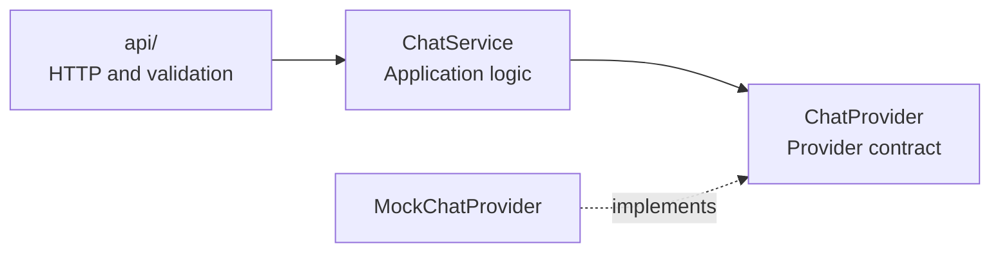

# PsyPedia backend

A **modular monolith inspired by ports and adapters (hexagonal architecture)**. HTTP routes, application logic, and answer providers stay separate; the service depends on a provider contract rather than a concrete model. The approach is deliberately lightweight: only a mock provider exists, with no model, retrieval, or persistence.

## Architecture



`create_app` injects the mock into the service. The API passes a validated, trimmed message to the service and returns the answer as JSON. Service and provider code do not depend on Flask. Replace the mock through `create_app` when a real provider is needed.

See [OpenAPI](../docs/openapi.yaml) for `GET /api/health`, `POST /api/chat`, and their response contracts.

## Development and tests

From the repository root, with Docker running:

```sh
make up                # Start with automatic reload
make test              # Backend contract and service tests
make test-integration  # Vite-to-Flask HTTP check; requires running services
```

Tests cover validation, responses, provider injection, and application isolation without a model. See [CONTRIBUTING](../CONTRIBUTING.md) for the development workflow.
