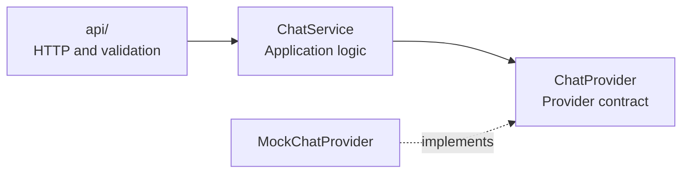

# PsyPedia backend

A **modular monolith inspired by ports and adapters (hexagonal architecture)**. HTTP routes, application logic, and answer providers stay separate; the service depends on a provider contract rather than a concrete model. The approach is deliberately lightweight: only a mock provider exists, with no model, retrieval, or persistence.

## Architecture



`create_app` injects the mock into the service. The API passes a validated, trimmed message to the service and returns the answer as JSON. Service and provider code do not depend on Flask. Replace the mock through `create_app` when a real provider is needed.

See [OpenAPI](../docs/openapi.yaml) for `GET /api/health`, `POST /api/chat`, and their response contracts.

## Development and tests

From the repository root, with Docker running:

```sh
make up                # Start with automatic reload
make test              # Backend contract and service tests
make test-integration  # Vite-to-Flask HTTP check; requires running services
```

Tests cover validation, responses, provider injection, and application isolation without a model. See [CONTRIBUTING](../CONTRIBUTING.md) for the development workflow.

## Real-model evaluation

With Ollama mode running:

```sh
make evaluate-llm EVAL_ARGS='--list'  # Show groups and case IDs, without inference
make evaluate-llm EVAL_ARGS='--execution application'  # Routing rules
make evaluate-llm EVAL_ARGS='--execution model'        # Real generation
make evaluate-llm EVAL_ARGS='--case grounded-act --repeat 3'
make evaluate-llm EVAL_ARGS='--report evaluation/reports/REPORT.json'  # Read only
```

[Cases](evaluation/cases.json) are grouped by emergencies, privacy, knowledge
limits, conversation, grounding, and educational safety. Run without filters to
execute all; repeat `--group` or `--case` to select several. Combining both filters
selects their intersection. Execution labels are expectations: unit tests verify
provider calls, while HTTP reports do not observe them directly.

The [runner](evaluation/run.py) saves raw responses, latency, source hashes, and
review criteria as ignored JSON reports. `--report` summarises them without new
inference. Repeated cases are not additional coverage; older runs describe their
recorded snapshot, not approval of current code.

### Evaluation summaries

[`evaluation/reports/summary.md`](evaluation/reports/summary.md) summarises the
evaluation results: what was tested, what worked, failures, and pending review.
It is a single report, updated as evaluations are repeated.

For changes to the model, prompts, cards, retrieval, guards, history, provider, or
generation options:

1. Rerun relevant synthetic cases and review answers against their rubrics and cards.
2. Update the summary with the date/model, commands, application/model coverage,
   automatic alerts, agent findings, human review status, and raw report filenames.
3. Include the updated summary in the PR and link it from the template. Repeat after
   further AI changes during review so the summary describes the tested behavior.

Only `summary.md` is tracked in `reports/`; raw JSON remains local. Keep human
reviews pending until a person records a decision. Passing keyword checks or
completing an evaluation is not approval. CI uses mocks and downloads no models.
